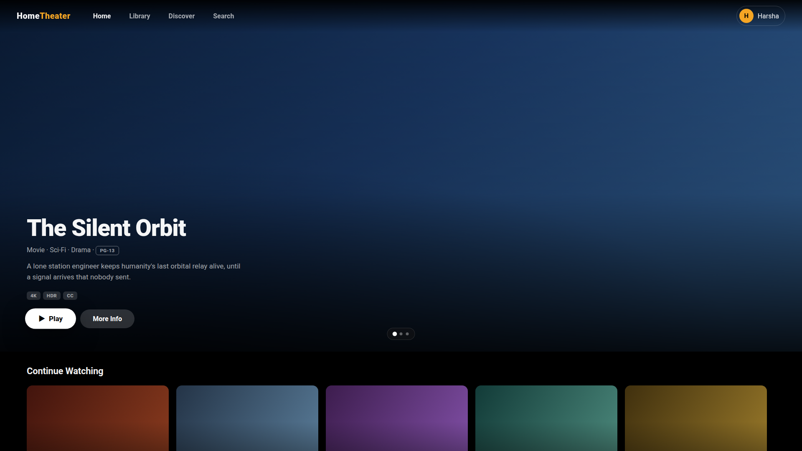

# Home Theater

Self-hosted household media library and playback product — Apple TV-inspired, **TV-first** cinematic UI.

**Status:** design phase → thin vertical slice. No product code claims beyond what is listed in [docs/STATUS.md](docs/STATUS.md).

## Core confirmed product rules

1. Household profiles are **passwordless** (no password/PIN to select a profile).
2. **Administrator password required for movie deletion** — enforced **server-side**, with an audit
   trail that never stores the secret.
3. **Apple TV-inspired cinematic UI**, original identity — **TV (10-foot, D-pad) is the primary
   experience**; mobile/desktop/web adapt the same design system.
4. "Remove from library" ≠ "delete file" — separate operations, deliberate confirmation, exact
   target+path shown before any file deletion.

## Repository layout

```
design/prototype/   # Working TV-first UI prototype (open index.html — no build step)
docs/               # Design system, roadmap, status
```

## Quick start (prototype)

Open `design/prototype/index.html` in any browser, or serve it:

```bash
python3 -m http.server 8080 --directory design/prototype
```


*Verified rendering via REA browser capture (evidence `ev_1197…c4c3a8` — see AGENT_STATE research).*

Navigate with **arrow keys** (D-pad simulation), **Enter** to select, **Escape/Backspace** for back,
**P** for the passwordless profile switcher. Mouse hover mirrors focus.

Data in the prototype is **MOCK sample data** — nothing is loaded from a server.
